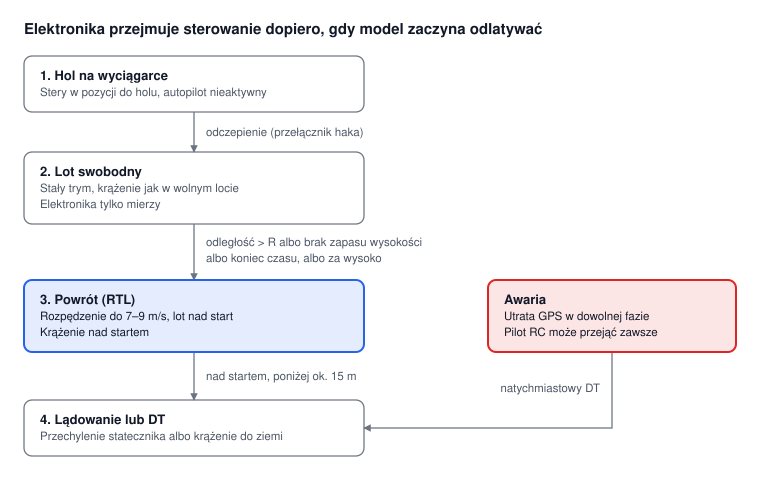

# Szybowiec holowany z automatycznym powrotem

Notatka z rozmowy, modelarnia lotnicza na Bródnie · 19.10.2026 · Paweł Nawrocki

Zadanie

dobrać elektronikę do istniejącego szybowca holowanego wzorowanego na F1H, tak aby sam wracał nad miejsce startu, gdy zacznie odlatywać albo zabraknie mu wysokości. Przepisy F1H zabraniają takiej automatyki (żyroskop, akcelerometr, GPS, kontroler lotu), więc będzie to model eksperymentalny do treningu, nie do zawodów. Model już jest, więc teraz chodzi tylko o dobór i montaż elektroniki. Poniżej opisuję koncepcję i proszę o opinię oraz wskazówki.

**Aktualizacja 20.10.2026** po uwagach instruktora modelarni: hol ręczny, powrót po zakończeniu czasu zadania, lądowanie bez krążenia nad startem, RC w czasie zadania tylko do awaryjnego DT, masa elektroniki ok. 30 g.

## Problem

Szybowce holowane ręcznie często odlatują daleko już przy słabym wietrze i giną. Najczęściej dzieje się to wtedy, gdy model wejdzie w komin i wiatr znosi go razem z noszeniem. Celem projektu jest elektronika, która w takiej sytuacji przejmie sterowanie i sprowadzi model nad start.

## Ograniczenia fizyczne

Powrót jest możliwy tylko wtedy, gdy model ma zapas wysokości i jest szybszy od wiatru. Z tego wynikają trzy założenia:

1. **Szybowiec nie utrzyma pułapu.** Bez noszeń opada ok. 0,4–0,6 m/s, w kominie się wznosi. Chodzi więc o lot swobodny przez czas zadania i powrót, zanim zabraknie wysokości.
2. **Model jest wolny.** Leci 4–6 m/s, więc przy wietrze 5 m/s pod wiatr praktycznie stoi. W trybie powrotu autopilot musi go rozpędzić do ok. 7–9 m/s kosztem większego opadania.
3. **Głównym wyzwalaczem jest czas.** Powrót zaczyna się po zakończeniu zadania: 60–120 s w F1H, 180–240 s w F1A. Odległość od startu i zapas wysokości to dodatkowe zabezpieczenia, które mogą uruchomić powrót wcześniej.

Przybliżony zapas wysokości potrzebny na powrót (d – odległość od startu, w_s – opadanie, v – prędkość lotu, w – wiatr czołowy):

```
H ≈ d × w_s / (v − w) + zapas
```

Przykład: 200 m od startu, wiatr 3 m/s, prędkość 7 m/s i opadanie 0,8 m/s dają ok. 40 m plus zapas.

## Logika lotu



1. **Hol ręczny.** Stery w pozycji do holu, autopilot nieaktywny. → odczepienie (przełącznik haka)
2. **Zadanie: lot swobodny.** 60–120 s (F1H), stały trym jak w wolnym locie. Elektronika tylko mierzy, RC tylko do awaryjnego DT. → koniec czasu zadania, albo wcześniej: odległość > R lub brak zapasu wysokości
3. **Powrót (RTL).** Rozpędzenie do 7–9 m/s, lot nad start. Pilot RC może od tej chwili przejąć stery. → model nad startem
4. **Lądowanie.** Od razu po dolocie, bez krążenia nad startem.

**Awaria:** utrata GPS w fazie powrotu oznacza natychmiastowy DT.

Przez czas zadania model leci jak zwykły wolnolatający szybowiec, a RC służy tylko do awaryjnego DT. Autopilot włącza się po zakończeniu zadania albo wcześniej, gdy model przekroczy granice. Po dolocie nad start od razu ląduje, a przy utracie GPS w fazie powrotu uruchamia determalizator (DT).

## Sprzęt

Docelowa masa elektroniki to ok. 30 g, a 45 g to już za dużo. Dla porównania istniejący w modelarni system (zegar z serwami, RDT, przełącznik haka i zasilanie) waży 12–15 g. Czy zmieści się w modelu, zależy od jego obecnej masy, miejsca w kadłubie i wyważenia, dlatego najpierw trzeba je zmierzyć. Lotki nie są potrzebne, wystarczy klasyczny układ wolnolatający: ster kierunku i statecznik.

| Element | Przykład | Masa (g) |
| --- | --- | --- |
| Kontroler lotu | płytka H743 (np. Matek H743-mini lub WLITE), H7 ze względu na skrypty Lua | 5–8 |
| GPS z kompasem | mały moduł u-blox M10 | 5–10 |
| Barometr | zwykle wbudowany w kontroler | – |
| 2 serwa | ster kierunku i statecznik (wysokość i DT), micro 2–4 g | 5–8 |
| Odbiornik RC | ExpressLRS nano, do ręcznego przejęcia sterowania | 1–2 |
| Akumulator | 1S 300–450 mAh z małą przetwornicą 5 V | 10–15 |
| Przełącznik haka | mikroprzełącznik wykrywający odczepienie | 1 |

## Integracja z zegarem

Największy problem to połączenie z istniejącym zegarem. Dziś serwa są wpięte w zegar, a kontroler też musi nimi sterować w fazie powrotu. Zegar ma wolne wyjścia, które mogą uruchomić kontroler.

| Wariant | Jak działa | Plusy | Minusy |
| --- | --- | --- | --- |
| 1. Kontroler przejmuje funkcje zegara | Kontroler sam ustawia stery do holu i lotu swobodnego, odlicza czas i odpala DT | najlżejszy, jeden układ, jeden program | trzeba odtworzyć w kontrolerze wszystko, co robi zegar |
| 2. Multiplekser serw | W czasie zadania serwami steruje zegar. Po czasie zegar daje sygnał z wolnego wyjścia i kontroler przejmuje serwa | zegar bez zmian, szybki prototyp | kilka gramów więcej i dodatkowe połączenia |
| 3. Zegar jako źródło sygnału | Wyjścia zegara wchodzą do kontrolera, który przekazuje je do serw, a potem przejmuje sterowanie | jedna ścieżka do serw | najbardziej skomplikowany |

Wariant 2 nadaje się na szybki prototyp z obecnym zegarem, wariant 1 na rozwiązanie docelowe. Do omówienia z elektronikiem modelarni: jak zrealizować dwa programy, czyli (1) hol i lot swobodny oraz (2) tryb automatyczny.

## Oprogramowanie

Planuję użyć ArduPilota (ArduPlane) z własnym skryptem Lua. Daje on więcej swobody niż INAV, który jest prostszy w konfiguracji, ale słabiej się rozszerza.

- `RUDDER_ONLY = 1` pozwala sterować samym sterem kierunku, bez lotek.
- Wbudowane są geofence z akcją powrotu (RTL), lądowanie, lot bez czujnika prędkości i parametry szybowca. Krążenie nad startem nie jest potrzebne: po dolocie model od razu ląduje.
- Skrypt Lua wykrywa odczepienie, odlicza czas zadania, pilnuje granic (odległość, wysokość), włącza powrót i lądowanie, a w razie potrzeby DT.
- W czasie zadania skrypt ignoruje sterowanie z RC poza awaryjnym DT. Przejęcie sterów odblokowuje dopiero faza powrotu.

**Wariant uproszczony na początek:** automatyczny DT z geofence. Wystarczą ESP32 lub Arduino, GPS i jedno serwo. Po przekroczeniu np. 150 m od startu albo zadanej wysokości determalizator sprowadza model w pobliżu startu, choć nie dokładnie na nie. Takie rozwiązanie jest tanie, lekkie i niezawodne.

**Trymowanie z RC na treningu.** Model oblatuje się i trymuje z RC, a system zapamiętuje położenia sterów dla holu i lotu swobodnego. Potem odbiornik można wyjąć i model lata na zapisanych nastawach. Podobnie działa już rosyjski zegar zintegrowany z RC. Bardzo przyspiesza to oblatywanie i testy.

## Przepisy i bezpieczeństwo

Z autopilotem model staje się w świetle prawa UE bezzałogowym statkiem powietrznym. Jeśli waży poniżej 250 g i nie ma kamery, mieści się w kategorii otwartej.

- Model startuje jako swobodnie latający. Automatyczne sterowanie w oparciu o GPS działa dopiero w fazie powrotu i od tego momentu pilot musi móc przejąć stery z RC, w zasięgu wzroku.
- Przepisy sportowe zabraniają użycia RC do czegokolwiek poza awaryjnym odpaleniem DT, więc w czasie zadania zawodnik nie może włączyć sterowania z RC.
- Czy taki podział spełnia przepisy o bezzałogowcach, trzeba potwierdzić w ULC. Tam też należy sprawdzić wymagania co do rejestracji operatora.
- Testy stopniowe: najpierw lot ręczny na RC, potem samo RTL z ręki, na końcu pełny cykl z holu.
- Loty z dala od ludzi i lotnisk.

## Plan prac

1. Pomiar modelu: masa, środek ciężkości, miejsce w kadłubie, istniejące serwa, zegar i DT.
2. Wybór wariantu integracji z zegarem (wspólnie z elektronikiem modelarni).
3. Dobór elektroniki i bilans masy, cel ok. 30 g.
4. Montaż i uruchomienie kontrolera na stole: stery, kierunki wychyleń, failsafe, blokada RC w czasie zadania.
5. Loty ręczne na RC i trymowanie z elektroniką na pokładzie.
6. Test powrotu i lądowania przy słabym wietrze.
7. Skrypt z wyzwalaczem czasowym i dodatkowymi granicami.
8. Pełne loty z holu ręcznego.

## Pytania otwarte

- Czy system 12–15 g, który już lata, to zegar z RDT, czy kontroler z GPS?
- Jakie wolne wyjścia ma zegar i jakim sygnałem może uruchomić kontroler?
- Który wariant integracji z zegarem wybrać na prototyp, a który docelowo?
- Ile waży model, gdzie ma środek ciężkości i ile wolnego miejsca jest w kadłubie?
- Czy model udźwignie ok. 30 g elektroniki bez utraty osiągów?
